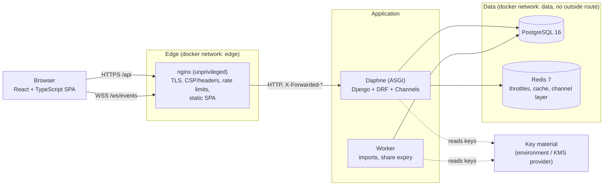
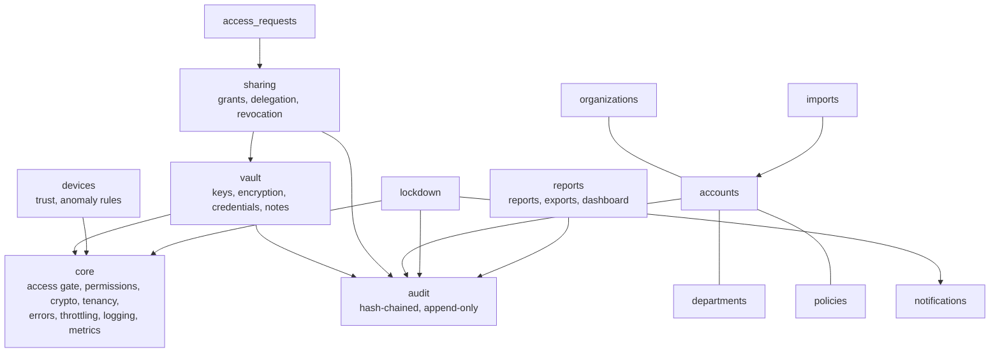
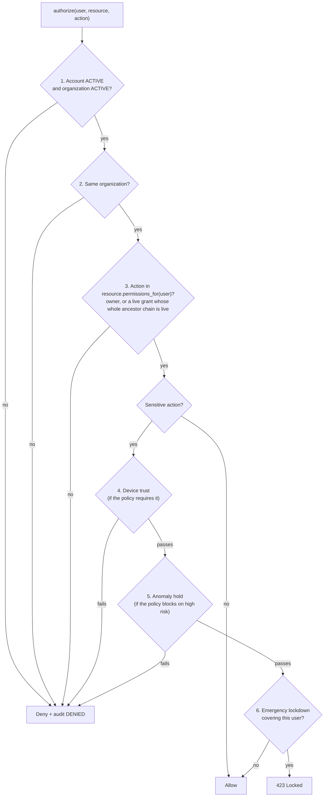
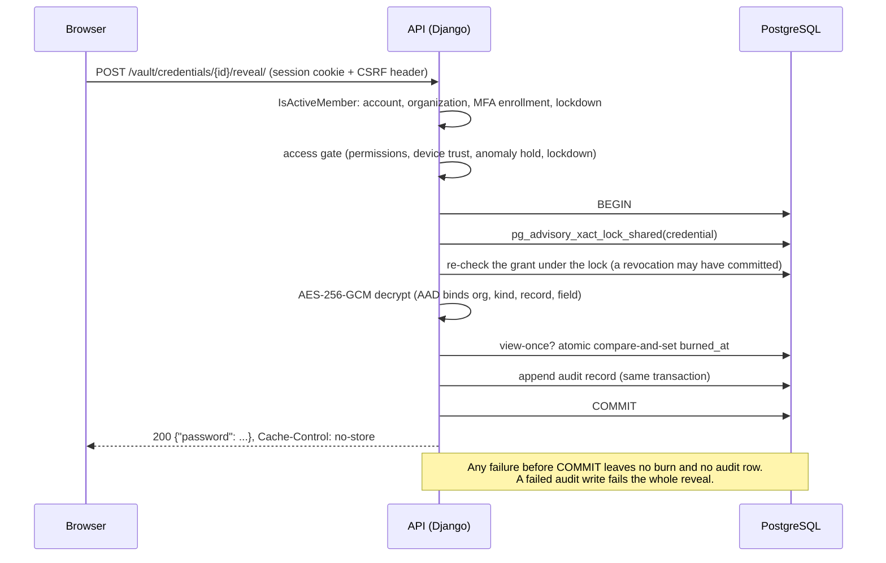
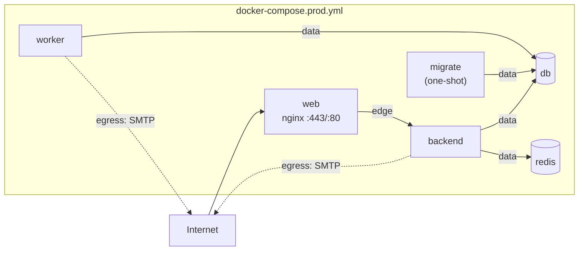

# Architecture

SecureVault is a multi-tenant credential and access management platform. This page describes how the pieces fit
together and why. Security properties and their limits are in [security-model.md](security-model.md) and
[known-limitations.md](known-limitations.md); the database is in [database-design.md](database-design.md).

## Components



| Part | Technology | Responsibility |
|---|---|---|
| Frontend | React 19, TypeScript, Vite, Tailwind, React Router, React Query, react-hook-form + zod | Presentation only. Never decides authorization; hides what the server would refuse. Holds no secret beyond a few seconds in component state. |
| Edge | nginx (unprivileged) | TLS, security headers and CSP, per-IP rate limits on sign-in paths, static files, reverse proxy for `/api/` and `/ws/`. Does not route `/api/v1/metrics/`. |
| API | Django 5.2, DRF, Daphne | Authentication (cookie sessions + CSRF), authorization, encryption, audit, all business rules. |
| Real time | Django Channels over Redis | Notifications and lockdown push. **A notification channel only**: every rule is also enforced by the API. |
| Worker | `manage.py run_worker` | Queued Excel imports; share-expiry notifications. Claims jobs with `SELECT ... FOR UPDATE SKIP LOCKED`, so several workers can run. |
| Database | PostgreSQL 16 | System of record; advisory locks for concurrency; trigger for append-only audit. |
| Redis | Redis 7 | Rate-limit counters, login lockout counters, Channels groups. Holds no secrets and nothing that cannot be lost. |

Not used, deliberately: Kubernetes, a message broker, microservices. The workload is small and the existing pieces
(PostgreSQL row locking, a polling worker) are enough; see [roadmap.md](roadmap.md) for when that would change.

## Backend module boundaries



Rules that keep it maintainable:

- Views are thin; business rules live in `services.py` functions that run inside a transaction.
- Every list is built from an organization-scoped queryset (`core.tenancy`). A foreign id behaves like a missing one (404),
  and the attempt is audited as DENIED.
- Cross-cutting zero-trust checks register themselves with `core.access_gate` from each app's `ready()`, in
  `INSTALLED_APPS` order (see below).

## The zero-trust gate

Authentication is never enough to reveal a secret. Every sensitive action (`REVEAL`, `COPY`, `EDIT`, `SHARE`,
`DELETE`) goes through `core.access_gate.authorize(user, resource, action)`:



Roles never appear in step 3: an organization administrator has no special access to a secret. Roles only grant
*administrative* permissions (manage users, view audit, activate lockdown), listed in `core.permissions`.

## Reveal, step by step



Revocation takes the same advisory lock **exclusively**, so a reveal either sees the revocation or finishes before it;
there is no window in which a revoked grant still reveals. Concurrency tests cover this (see
[test-report.md](test-report.md)).

## Emergency lockdown

```mermaid
sequenceDiagram
    participant S as Security admin
    participant A as API
    participant DB as PostgreSQL
    participant R as Redis
    participant E as Employee browser (WebSocket)
    S->>A: POST /lockdown/activate/ (reason, password re-entry)
    A->>DB: BEGIN; insert LockdownState (active)
    A->>DB: COMMIT
    Note over A,DB: From this commit on, every sensitive API call is refused (423),<br/>whether or not any socket hears about it.
    A->>R: publish lockdown.activated (after commit, best effort)
    R-->>E: lockdown.activated, then close code 4423
    A->>DB: delete the affected users' sessions
    E->>E: shows the lockdown screen / sign-in
```

Phase order matters: the state is committed first, the notification is sent second, sessions are killed last. If Redis
is down the push is lost but the lockdown still holds. Measured propagation is in [test-report.md](test-report.md).

## Real-time channel

`/ws/events/` authenticates with the same session cookie, checks the `Origin` header against `ALLOWED_HOSTS`, and
re-checks the account and any lockdown at handshake, so reconnecting cannot bypass a lockdown. Refusals are
*accept-then-close* with an application code (4401 unauthenticated, 4423 lockdown, 1011 real-time layer unavailable);
rejecting the handshake would show up as an indistinguishable 1006 in browsers.

## Deployment topology



Three database identities: a bootstrap superuser known only to the database container, an owner role used only by the
one-shot `migrate` job, and a restricted application role for everything that runs continuously (cannot alter the
schema or UPDATE/DELETE/TRUNCATE the audit trail). See [deployment-guide.md](deployment-guide.md).

## Scaling notes (measured, not promised)

Each Daphne process runs synchronous DRF views on one thread, so one process serves roughly one request at a time.
On a laptop, one backend container handled about 28 requests/second of typical list endpoints before queueing
(p50 450-720 ms at 20 concurrent users; zero errors). Scale by running more backend containers behind nginx
(WebSockets already fan out through Redis). No horizontal-scaling test has been run. Details: [test-report.md](test-report.md).
