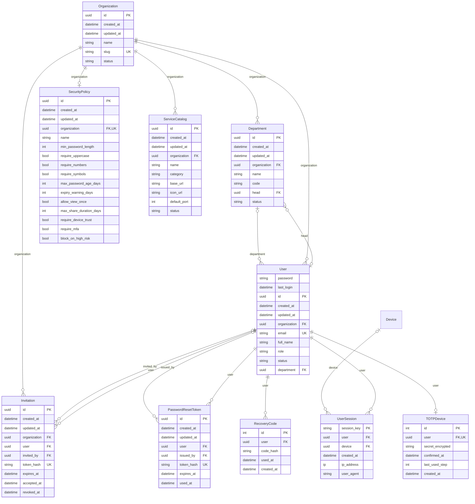
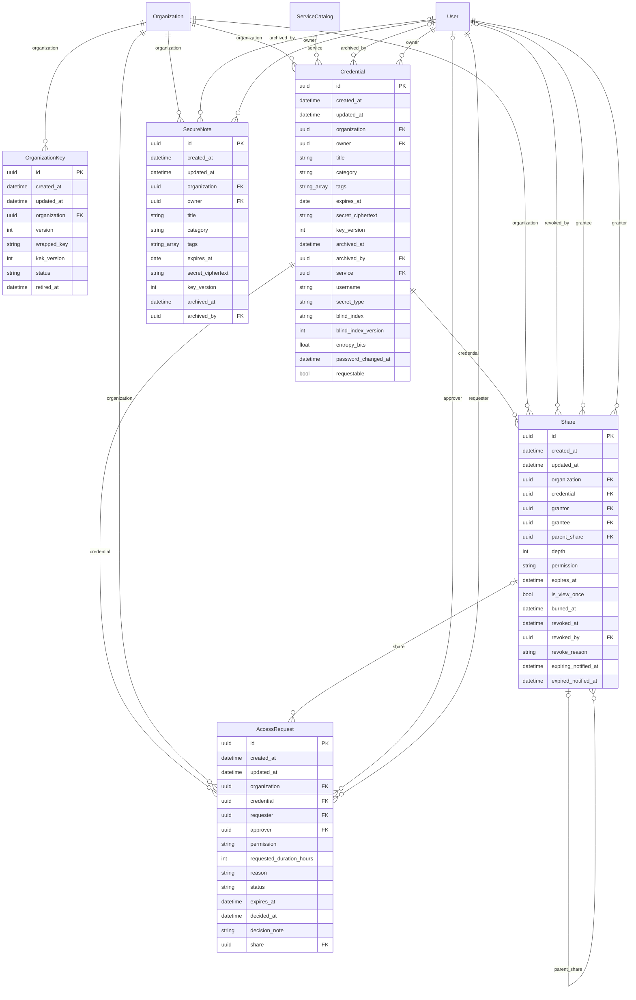
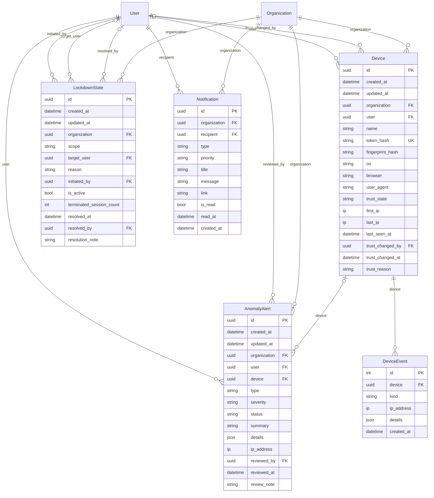
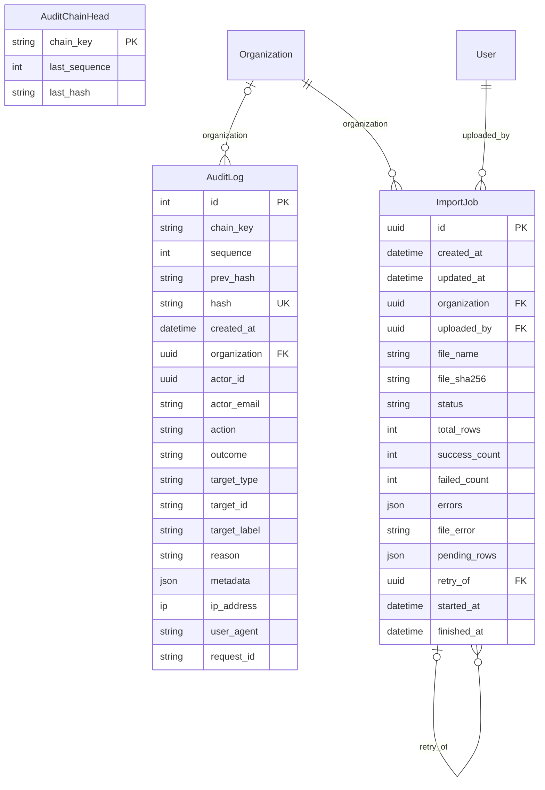

# Entity-relationship diagrams

<!-- Generated by `manage.py er_diagram`; do not edit. -->

## Identity, organization and policy

Who exists, which organization they belong to, how they sign in, and the organization's rules.

## Vault, sharing and access requests

Encrypted items, the keys that protect them, delegated access and the requests that lead to it.

## Devices, anomalies, lockdown and notifications

Zero-trust signals and controls.

## Audit and imports

The tamper-evident trail and bulk onboarding.

