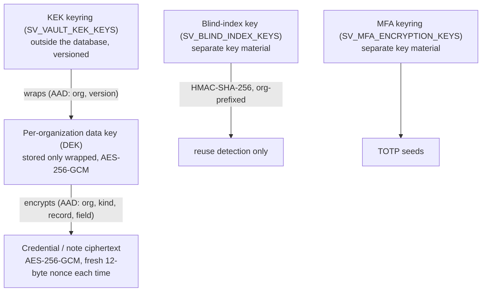

# Security model

What SecureVault protects, how, and where the protection ends. Evidence for each claim is a named test or a measured
result in [test-report.md](test-report.md). Nothing here is a certification, a penetration test or an audit: the
project has not had one (see [known-limitations.md](known-limitations.md)).

## Positioning: server-side envelope encryption, not zero-knowledge

The server decrypts credentials on request (it must, to show them to an authorized person), and it holds the
key-encryption key. **SecureVault is therefore not zero-knowledge**: an attacker who obtains the database *and* the key
material, or who controls the running server, can read secrets. The design is "zero-knowledge-oriented" in the narrower
sense that a **database copy alone is useless**, the application never logs or caches plaintext, and access is
authorized, limited and audited per request.

## Key hierarchy

- **Algorithms:** AES-256-GCM and HMAC-SHA-256 from the `cryptography` library; Argon2id for passwords. No custom cryptography.
- **Binding:** the authenticated data ties each ciphertext to its organization, record kind, record id and field, so moving a
  ciphertext to another row or tenant makes it fail to decrypt (tested).
- **Separation:** the KEK, blind-index and MFA keyrings must be different material; the application refuses to start otherwise (tested).
- **Rotation:** keyrings are versioned (`1:...,2:...`; the highest version encrypts, all listed versions decrypt).
  `manage.py rotate_vault_keys` re-wraps the data keys under the new KEK, rotates the data keys and re-encrypts items,
  and rebuilds blind indexes (tested).
- **Custody:** keys come from a `KeyProvider`. Only the environment provider exists; a KMS-backed provider is the
  intended production target and is **not implemented** (roadmap). Losing the KEK makes all stored secrets unrecoverable;
  back it up separately from database backups.

## Authentication and sessions

- **Cookie sessions, not JWTs.** Sessions live in the database, so a lockdown, suspension or password change can end them
  immediately by deleting rows. `sv_session` is HttpOnly, Secure and SameSite=Strict in production (verified in a real browser).
- **CSRF:** every write needs the `X-CSRFToken` header matching the cookie, and an acceptable `Origin`. Sign-in itself is
  CSRF-protected. The session key is rotated at sign-in (session-fixation test).
- **Brute force:** login attempts are counted per hashed email (existing or not, so lockout reveals nothing): 5 failures
  lock that email for 15 minutes; per-IP and per-user throttles apply on top; nginx adds a per-IP limit on sign-in
  paths. If Redis (the counter store) is unreachable, credential endpoints answer 503 rather than allow unlimited guesses.
- **Second factor:** TOTP with replay protection (a code is accepted once) and single-use recovery codes; seeds are encrypted
  at rest. An organization policy can require it; users who must enrol are confined to the enrolment screens.
- **Passwords:** Argon2id, Django validators plus an organization policy (length, classes). Reset and invitation links are
  256-bit single-use tokens stored hashed; the token sits in the URL *fragment*, so it never reaches a server log.
  Password reset answers identically for unknown accounts, including when email delivery fails.
- **High-risk actions** (activating or lifting a lockdown) require re-entering the password (and TOTP code if enrolled).
- **No default administrator.** The first administrator is created with `manage.py bootstrap_org`; the password is typed
  at a prompt or read from `SV_BOOTSTRAP_PASSWORD`.

## Authorization

- **Roles** (Organization Admin, Security Admin, Employee) grant only *administrative* permissions, listed in
  `core/permissions.py`. No role grants access to a secret.
- **Secrets** are reachable by the owner, or through a live share grant. The gate (see [architecture.md](architecture.md))
  re-evaluates organization, grant, device trust, anomaly hold and lockdown on every reveal, copy, edit and share.
- **Tenancy:** all queries are organization-scoped; foreign ids are 404 and audited as DENIED. Nothing trusts a role,
  organization id or permission sent by the browser; the permission list in `/auth/me/` only hides UI.
- **Delegation:** a grantee can pass on at most what they hold (permission and expiry), to depth 5. Revoking a grant revokes
  everything delegated from it, in one statement; access evaluation also checks the whole ancestor chain, so a missed row
  cannot leave access behind. Suspending a person pauses everything delegated *through* them.
- **View-once** limits how many times *SecureVault displays* a secret (consumption is an atomic compare-and-set; a later
  attempt is HTTP 410; a refused attempt does not burn it). **It cannot prevent screenshots, photographs or manual copying**,
  and the UI says so.

## Devices and anomalies (signals, not proof)

A device is identified by a random server-issued cookie (`sv_device`, HttpOnly, SameSite=Strict; only its hash is stored).
Browser fingerprint attributes (OS, browser, similar) are *risk signals only*: they are client-reported and forgeable.
Administrators approve, suspend or revoke devices; a policy can require a trusted device for sensitive actions. Anomaly
rules are transparent and rule-based: new device, new network (/24 or /48), fingerprint mismatch, untrusted device, and
more than 20 reveals in 10 minutes. They create alerts and, if the policy says so, hold sensitive actions. They will miss
a careful attacker on a trusted device and can false-alarm on travel.

## Emergency lockdown

Server-enforced and independent of any notification. See the sequence in [architecture.md](architecture.md). While
active, no one covered (all employees, or the targeted account; administrators keep their sessions to manage the incident
but cannot reveal, copy, edit or share) can use secrets; the API answers 423. Tested with the real-time layer down.

## Audit

Append-only (model, trigger and, in production, database privileges), hash-chained per organization, fail-closed (a
sensitive action whose audit write fails is rolled back). Metadata is sanitized by key: anything under a key that looks
like a password, secret, token, key, cookie, session and similar is replaced by `[REDACTED]`. Failed and denied attempts
are recorded too. See [database-design.md](database-design.md#the-audit-trail) for the limits of the chain.

## Data handling

- **Imports:** `.xlsx` only, size and row caps, ZIP/entry-size checks before parsing, XML parsed with defusedxml (entity
  expansion blocked), cells beginning with `=`, `+`, `-`, `@` rejected for names, privileged roles in a sheet are **rejected**
  (people are always invited as Employees; roles are changed afterwards by an administrator), each row in its own transaction.
- **Reports and exports:** allow-listed datasets, columns and filters; always organization-scoped; no secret material,
  ciphertext or blind index in any column. CSV, Excel and PDF exports neutralize formula injection; exports are capped
  (10,000 rows; PDF 2,000) and audited.
- **Browser:** secrets live in component state for at most a few seconds; never in the React Query cache, local/session
  storage or logs. Clipboard copy is cleared after 30 s (best effort; a browser may block it).

## Transport, headers and edge

TLS 1.2/1.3 at nginx; HSTS; a CSP with no `unsafe-inline`/`unsafe-eval` and no third-party origins (verified with zero
violations in a real browser); `nosniff`, frame denial, referrer and permissions policies; API responses are
`Cache-Control: no-store`. The API serves JSON only; API docs and metrics are off unless enabled; there is no Django admin.

## Operational hygiene

- **Logs:** JSON with a request id; the access log carries route pattern, status, duration and ids, never query strings,
  headers, cookies or bodies. The smoke test greps all service logs for every secret it created and finds none.
- **Least privilege:** three database roles; containers run unprivileged with read-only filesystems and no capabilities;
  only nginx publishes ports.
- **Supply chain:** exact version pins, `pip-audit` and `npm audit` (clean at the time of writing), gitleaks over the
  full history, Dependabot, CI actions pinned to commit SHAs.
- **SSRF:** the server never fetches a URL a user supplies (service-catalog URLs are stored text).
- **Secrets in git:** `.env` files and keys are ignored; `.env.example` and `.env.prod.example` hold placeholders only.

## What this does not protect against

- A compromised application server or host (it can read keys and plaintext in memory).
- Theft of the database **and** the key material together.
- Authorized users copying secrets they were allowed to see.
- A malicious or compromised browser on the user's machine.
- Insider with the ability to rewrite the entire audit table and recompute the chain (mitigated by role separation, not eliminated).
- Denial of service beyond the rate limits and resource caps described; no DDoS protection is included.
